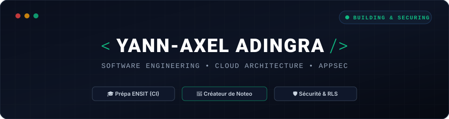

  

  <h1>Yann-Axel Adingra</h1>
  
<strong>Étudiant ingénieur à l'ENSIT Abidjan · Développeur Full-Stack</strong>

  
Je conçois des applications web utiles, de l'architecture au déploiement.

  <a href="https://noteo-v1-7.vercel.app/login">Noteo</a> ·
  <a href="https://www.linkedin.com/in/mian-yann-axel-adingra-1ba74b436/">LinkedIn</a> ·
  <a href="mailto:adingrayann08@gmail.com">Me contacter</a>

---

<h3> À propos</h3>

Basé en Côte d'Ivoire, je m'intéresse à l'architecture full-stack et à la sécurité applicative. Je développe **Noteo**, un SaaS scolaire en production.

<h3> Projet à la une</h3>

**[Noteo — application de suivi des moyennes scolaires](https://noteo-v1-7.vercel.app/login)**

Calcul des moyennes pondérées selon la série et le trimestre, avec une offre gratuite et une formule Pro.

`Next.js` · `React` · `Supabase / PostgreSQL` · `Google OAuth` · `Paystack` · `Vercel`

<h3> Technologies</h3>

  

**En apprentissage :** Python, Linux et sécurité applicative.

<h3> Activité GitHub</h3>

  
  

  

  <a href="https://github.com/adgynn-coding">Voir mes projets sur GitHub →</a>

